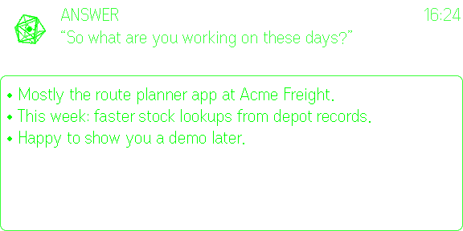
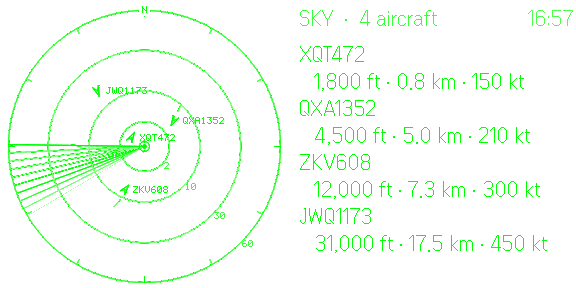
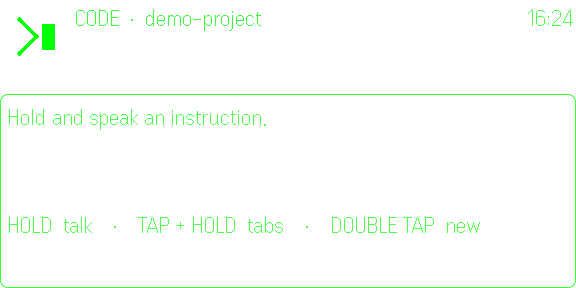

# G2 apps: Answers, Around, Sky, Code and HackOS

Five Even Hub apps for the Even Realities G2, sharing one design language
([DESIGN.md](DESIGN.md)) and one server on your Mac:

| App | What | Open in dev |
|---|---|---|
| **Answers** | A real-time teleprompter: when someone asks you a question, the glasses show a short answer. Meetings are saved to Obsidian. | `npm run sim` / `npm run qr` |
| **Around** | Your Loops city view (OSINT) as a full-screen live map: incidents, closures, trams, aircraft, you | `npm run sim:around` / `npm run qr:around` |
| **Sky** | A radar of the aircraft your Pi's ADS-B receiver hears | `npm run sim:sky` / `npm run qr:sky` |
| **Code** | Talk to Claude Code on your Mac, in tabs; approve risky steps with a tap | `npm run sim:code` / `npm run qr:code` |
| **HackOS** | Talk to your own model (Qwen on a Runpod GPU): hold to talk on the glasses, or use the terminal page on the Mac | `npm run sim:hackos` / `npm run qr:hackos` |

This is a personal project. Each app needs the server on your own Mac, and it was
checked in the simulator.

## Screens


Answers: a short answer to a question.


Answers: the recall cue for a person named in the conversation.


Around: the live city map with incidents.


Sky: the radar of nearby aircraft.


Code: the mark and status of a Claude Code session.

Add `?demo=1` to the Around or Sky URL (or `?demo=answer` for Answers) to see
sample data without the server. Answers also has `?demo=recall`. Demo pages
need no pairing key.

## Set up

1. `npm install`
2. `npm run setup:stt` (installs whisper.cpp and downloads the 465 MB English model)
3. `cp .env.example .env`, then add `ANTHROPIC_API_KEY`.
4. Create the pairing key: run `openssl rand -hex 24` and put the result in `.env` as `HUD_TOKEN=<value>`. The server will not start without it, or if it is shorter than 16 characters.
5. `cp context.example.md context.md`, then fill in `context.md`.

## Pairing key

Every glasses page needs the key in its URL as `?k=<HUD_TOKEN>`. A page opened
without it shows "No pairing key in the page URL". A wrong key shows as
disconnected and keeps retrying. `npm run qr`, `npm run sim` and their
`:around`, `:sky`, `:code` and `:hackos` variants add the key for you.
`npm run url:hackos` prints the HackOS page for the Mac browser.

The server listens on `127.0.0.1:8787` only. Phones reach it through the Vite
proxy on port 5173, so nothing connects to `<mac-ip>:8787`. `PORT` in `.env`
moves both. Browser pages must connect from the host that served them.

The traffic is plain `http` and `ws` on your Wi-Fi. The key, the audio, the
transcripts and the Code approvals are not encrypted. The key stops other devices
and web pages on your network. It does not stop someone who can read the Wi-Fi
traffic. The key is also in the QR code and in your browser history. Use a
network you trust.

## Around and Sky: Loops

Set `LOOPS_SSH=pi@raspberrypi.local` in `.env`. The server opens an SSH stream-local
forward to the Loops daemon's socket, exactly like Loops.app (BatchMode, strict
host keys, no TCP port), and only sends GET requests: location, city items, live
vehicles and aircraft, ADS-B, and the local map. Your position is the Pi's GPS fix,
else the place called Home. While the Pi is away, the apps say "Loops is not
reachable" and the server retries with backoff up to every 5 minutes. Around and
Sky also say why the live picture is missing: no pairing key, "HUD server is not
reachable.", or "No update from Loops for N min." (the phone and Mac clocks must
agree within about 45 s). Then no aircraft, incidents or vehicles are drawn and
nothing moves. If only one part of Loops answers, the other part says "No
incident data from Loops." or "No aircraft data from Loops.". The Around status
line shows the Loops area name, else "Home", "Here" or "No fix".

| On the glasses | Around | Sky |
|---|---|---|
| Swipe up / down | Previous / next page of the list | Previous / next page of the list |
| Tap | Back to page 1 | – |

## HackOS

One conversation with your own model, shared by the glasses and the Mac.

1. Set `HACKOS_URL` in `.env` to an OpenAI-compatible server, for example `https://<endpoint>.api.runpod.ai/v1`.
2. Save the API key in the Keychain: `security add-generic-password -a "$USER" -s runpod-api-key -w`. Or set `HACKOS_API_KEY` in `.env`.
3. `npm run dev`, then open the page that `npm run url:hackos` prints on the Mac. Type, or hold Space (or the Hold to talk button) to talk. The Mac microphone is open only while you hold, and closes if the window loses focus.

| On the glasses | Action |
|---|---|
| Hold | Talk; release to send |
| Double tap | While your speech is being transcribed: cancel it. While the model works or answers: stop. When idle: start a new chat, but only 1.5 s or more after an answer ended |
| Swipe up / down | Previous / next page of the answer |

The GPU sleeps when idle. The first message after a pause shows `WAKING THE GPU` and takes about a minute; later answers start at once. The server keeps the last 12 turns as context and forgets them when it restarts. Speech is transcribed on your Mac; the text of your messages goes to your model server. `HACKOS_MODEL` (default `qwen3.8-27b`) and `HACKOS_REASONING` (default `none`) are optional. The Stop button also cancels speech that is being transcribed. If the glasses microphone does not start, close HackOS on the glasses and open it again. A refused connection, an unknown host or a bad `HACKOS_URL` fails at once; timeouts and HTTP 408, 425, 429 and 5xx are treated as a waking GPU and retried for up to 3 minutes. After the model server rejects the key, the next message reads the Keychain again; a changed `HACKOS_API_KEY` needs a server restart.

## Code

Claude Code (through Anthropic's Agent SDK) works in the folders listed in
`CODE_DIRS`; each folder starts as a tab, and each tab is its own session that
remembers the conversation.

| Gesture | Action |
|---|---|
| Hold | Talk. The microphone is open only while you hold; release to send |
| Tap | Allow the step Claude is asking about (last page only, see below) |
| Double tap | Deny that step; or stop the running task; or cancel an instruction being transcribed; or, when idle for 1.5 s or more, start a new session |
| Tap, then hold | The tab menu: switch tab, open a new tab on the same project, close this tab |
| Swipe up / down | Previous / next page of a long result or approval |

A hold ends on its own after 60 seconds, and what was heard is thrown away, not
sent. A hold also ends without sending if the system menu opens, the app exits,
the connection drops or the page is hidden. Only a real release sends your speech.
A hold is refused while your last instruction is still being transcribed (Code and
HackOS): wait until the text appears.

When you close any of the five apps (system exit), the page stops its microphone,
images and timers and closes its connection, with no reconnect. Opening the system
menu does not.

What runs without asking:

- Reading and searching inside the tab's project. A path outside it (or a path
  starting with `~`, or a link that leads out) waits on the glasses. The
  project's own `.env` can be read without a tap.
- Edits to files inside the project, except `.git`, `.env` and `.env.*`, the
  `.claude` folder and `.mcp.json`. Those always wait. An edit through a link is
  judged by where the link lands. In a `CODE_DIRS` folder that is not a git
  repository, edits to a top-level `HEAD`, `config`, `commondir` or `packed-refs`
  file, or inside top-level `objects/` or `refs/`, also wait.
- Subagents (but one with isolation `worktree` or `remote` is refused).
- The shell commands Claude Code itself treats as read-only (like `ls`).

Everything else (other shell commands, edits elsewhere, web access, MCP tools)
waits on the glasses, one request at a time. Each gets 2 minutes from the moment
it is shown, then counts as denied. The glasses show the whole call in pages of 5
lines of 31 characters (about 155 characters a page), so a long call needs more
swipes. Non-ASCII characters and the backtick show as `\u{hex}`, because the
glasses font has no backtick. An edit with `replace_all` says "(every match)"; a
notebook edit shows its mode, cell and new source. For an edit to a protected file,
the glasses show the new content or the old and new text. Swipe down to read on. A tap allows
only on the last page, and only after that page has been on screen for 0.7 s; the
allow is sent 0.4 s later, and a double tap in that time denies instead. A double
tap denies at once. The server also ignores an Allow, from the glasses or the phone
page, that comes less than 0.7 s after the request went on show; click again.
A request longer than 3000 characters is denied without being
shown. The phone page shows the same text with Allow and Deny buttons.

Project rules apply (`CLAUDE.md`, and the hooks, permission rules and MCP servers
already in the project's `.claude/settings.json` or `.mcp.json`); your user-level
allow rules do not, so they cannot skip the glasses. Only new writes to those
files need a tap.

`CODE_DIRS` opens at most 6 tabs; extra folders are ignored with a warning. A
folder that does not exist gives the error "Folder in CODE_DIRS does not exist".
If the glasses microphone does not start, the app says so; close Code on the
glasses and open it again.

The HUD never shows spend. Each task still has a budget cap (`CODE_BUDGET_USD`,
default 2; it must be a number above 0) and runs on your Anthropic key.

## Answers

How it works:

1. The plugin runs inside the Even Realities app on your phone and streams the
   G2 microphones (16 kHz audio, tagged by the app as your speech or someone
   else's).
2. The answer server on your Mac cuts the audio into sentences and transcribes
   them locally with Whisper (whisper.cpp). Audio never leaves your Mac.
3. When a sentence from someone else ends, Claude decides whether it is a
   question for you. If it is, the answer streams to the glasses as it is
   written. A question you type in the phone page is always sent; spoken lines
   of fewer than 3 words are not.

4. Every conversation is saved to your Obsidian vault as a meeting note:
   summary, decisions, action items (as checkboxes), the answers you were
   shown, and the full transcript.

Your notes in `context.md` and the summaries of your recent meetings are sent
with every question, so answers can use your own facts and earlier
conversations.

What you notice on the glasses:

- A new line does not stop the answer on screen. Only a newer line that Claude
  treats as a question replaces it. A finished answer stays through remarks that
  are not questions, until a new answer starts or you double tap.
- Long press first finishes the sentence in progress, so "Saved" can take a few
  seconds longer. If audio stops for 1 s (paused, suspended page), the sentence
  in progress is ended and transcribed.
- If the glasses microphone does not open, or no audio arrives for about 10 s,
  Answers re-arms it once, then shows PAUSED with "MIC NOT AVAILABLE". Tap to
  retry.
- Closing the app releases the microphone, and the server saves the meeting.
- While listening is paused, a reconnect keeps PAUSED on the lens.
- The recall cue's 3 s and 10 s count from the moment the glasses accept the text
  that draws it.

## Vault recall

Answers can use your Obsidian notes. When someone names a person or a topic that
has a note, short extracts go to Claude with the request. When a known person is
named for the first time in a conversation, a two-line cue (name, a fact or two)
shows in the question box for 10 s. Try it with
`http://localhost:5173/apps/answers/?demo=recall`.

Set up (all three are needed; recall is off otherwise):

1. `OBSIDIAN_VAULT` and `HUD_USER_NAME` in `.env`.
2. `RECALL_FOLDERS`: vault folders the server may read, comma-separated (`.` is
   the whole vault), for example `People,Projects,Meetings,Daily`. The Meetings
   folder is read only if you list it.
3. Optional: `RECALL_EXCLUDE` (folders never read; no globs), `RECALL_PEOPLE`
   (folders that hold people, default `People`), `RECALL_CUE=off` (no cue;
   answers still use the vault).

A note whose title is only common or very short words ("Meeting notes", "Next steps")
matches only when written with a capital in mid-sentence; give it an alias that is
not a common word. Titles with an uncommon word ("Atlas migration") match in any case.
Set `HUD_USER_NAME` to the title of your own note, or add it as an alias on that
note: that note is then yours, never cued or sent, and meeting notes make no subject
for you.

The first scan runs in the background after start-up. Until it ends there is no
cue and no extracts. Edits to a note count at the next rescan, within about a
minute. A saved meeting note lists the notes that were quoted under
`## Vault notes sent to Claude`. Questions typed before any speech are not listed.

Off switches:

- Leave `RECALL_FOLDERS` empty and restart.
- Put `recall: false` in a note's frontmatter. It is then never sent and its
  name never matches. This also leaves a meeting note out of the 8 past-meeting
  summaries, even with recall off.
- List the folder in `RECALL_EXCLUDE`.

The filters that drop contact details, fields and secrets from the extracts are
best effort. Indented code blocks and `<pre>` blocks are not removed. Use fenced
code blocks (``` or ~~~) for anything that must stay on the Mac. See Privacy.

## Meeting notes in Obsidian

Set `OBSIDIAN_VAULT` in `.env`. Notes go to `<vault>/Meetings`:

- While a conversation runs, the transcript is appended live to
  `YYYY-MM-DD HH-mm Conversation (recording).md`, so nothing is lost if the
  server stops.
- When it ends, Claude writes the summary and the draft is replaced by
  `YYYY-MM-DD HH-mm <title>.md`, with `people`, `topics` and `tags: [meeting]`
  in the frontmatter.
- A conversation ends when you long-press on the glasses, after 10 minutes
  without speech (`MEETING_IDLE_MINUTES`), or when the glasses page
  disconnects. On Android a locked phone can end it early.
- If the vault folder cannot be written, the glasses say so for the live draft and
  once more when the 10-minute idle end fails; the idle timer then stops retrying
  that conversation. The transcript is written first; if the summary fails, the
  conversation stays in server memory. It is saved at the next idle end after new
  speech, at a long press (each failed press shows the error), or when the page
  disconnects.
- Each conversation has its own draft. A draft left by a stopped server is kept
  but not finished for you.

## Run in the simulator (no glasses needed)

```
npm run dev
npm run sim
```

The simulator uses your Mac's microphone. You can also type a question in the
page's text box.

## Run on the glasses

1. Turn on developer mode in the Even Realities app (Even Hub tab).
2. Keep the phone and the Mac on the same Wi-Fi.
3. `npm run dev`, then `npm run qr` (or `qr:around`, `qr:sky`, `qr:code`, `qr:hackos`) in a second terminal.
4. In the Even Hub tab, tap Scan QR and scan the code.

The `apps/*/app.json` files hold a placeholder network whitelist. To pack the apps, set
`HUD_ORIGIN` in `.env` to the origin of your Mac server, for example
`HUD_ORIGIN=http://<your-mac-lan-ip>:5173` (scheme, host and port, no path), then run
`npm run pack`. It builds `answers.ehpk`, `around.ehpk`, `sky.ehpk`, `code.ehpk` and
`hackos.ehpk`, with your origin written into stamped copies of the manifests in
`dist/manifests/`. Without `HUD_ORIGIN`, `npm run pack` stops with a message. If your
Mac's LAN address changes, change `HUD_ORIGIN` and pack again.

## Controls on the glasses

| Gesture | Action |
|---|---|
| Tap | Pause or resume listening |
| Double tap | Clear the answer (and drop the rest of one that is still streaming) |
| Swipe up / down | Previous / next page of the answer |
| Long press | End the conversation and save it to Obsidian |

## Tuning

- `CARD_CHARS` and `CARD_LINES` in `src/answers/hud.ts` were measured in the
  simulator. Adjust them after you see real text on the glasses.
- `server/segmenter.ts` decides when a sentence ends (700 ms of silence by
  default). Lower `silenceMs` for faster answers, raise it if sentences get cut.
- `CLAUDE_MODEL` and `CLAUDE_EFFORT` in `.env` trade speed against quality.
  The default is `claude-opus-5-5` at `low` effort.
- `LOG_LEVEL=debug` logs how long each transcription takes.

## Privacy

Audio goes from your phone to your Mac and is transcribed there. Transcript
lines, `context.md` and recent meeting summaries go to Anthropic. Meeting notes
are plain files in your vault; if you sync the vault, they sync too. Tell people when you record a
conversation where the law or politeness requires it.

With vault recall on (`RECALL_FOLDERS`), the server reads the first 64 KB of each Markdown note in those folders, on your Mac, and keeps short extracts in memory. When a line of the conversation names a person or topic that has a note, extracts about at most 3 of them (at most 6 notes and 1,600 characters) go to Anthropic with the request: the start of the note, one matching paragraph, one meeting's summary, decisions and open tasks, and open tasks from listed daily notes that name them. A request goes out for every sentence of three or more words from someone else, and for every typed question, because Claude decides whether it is a question. The extracts go with it: for a person, until the conversation ends or 60 minutes after the last mention; for a topic, while its name is in the last 16 lines. A note shorter than these limits can be sent whole. Lines that look like fields (`Email: …`, `phone:: …`), email addresses, phone numbers and lines like `password: …` are left out, but this filter is best effort. Hidden folders such as `.obsidian`, symlinks, `RECALL_EXCLUDE` folders and folders you did not list are never read. Notes with `recall: false` are never sent, and their names never match. A person whose note is in an excluded folder can still be recalled through a listed meeting note that names them: to keep someone out, put `recall: false` on their note in a listed folder, or on the meeting note. `RECALL_FOLDERS` and `RECALL_EXCLUDE` control only these extracts. The summaries of your 8 most recent meetings still go with every request, as before, except meeting notes marked `recall: false`. The recall cue is made on your Mac and goes to your phone and glasses like answers do; the phone page shows only the name. Each meeting note of a spoken conversation lists the vault notes that were quoted. The server never writes outside `Meetings`.

The Code app sends your instructions, and the files Claude reads, to Anthropic.
HackOS sends the text of your messages to your own model server.

## Scripts

| Script | What |
|---|---|
| `npm run dev` | Whisper, the server and the web page together (`dev:stt`, `dev:server`, `dev:web` alone) |
| `npm run sim`, `sim:around`, `sim:sky`, `sim:code`, `sim:hackos` | The simulator, with the pairing key |
| `npm run qr`, `qr:around`, `qr:sky`, `qr:code`, `qr:hackos` | A QR code for the phone, with the pairing key |
| `npm run url:hackos` | The HackOS page for the Mac browser |
| `npm run setup:stt` | Install whisper.cpp and the model |
| `npm run build`, `npm run pack` | Build the five apps; pack them as `.ehpk` |
| `npm run typecheck`, `npm test` | Checks |

## Environment

All variables are optional except `HUD_TOKEN`. See `.env.example`:
`ANTHROPIC_API_KEY`, `HUD_TOKEN`, `OBSIDIAN_VAULT`, `MEETINGS_FOLDER`,
`MEETING_IDLE_MINUTES`, `HUD_USER_NAME`, `CONTEXT_FILE`, `CLAUDE_MODEL`,
`CLAUDE_EFFORT`, `WHISPER_URL`, `PORT`, `LOG_LEVEL`, `LOOPS_SSH`, `CODE_DIRS`,
`CODE_MODEL`, `CODE_BUDGET_USD`, `HACKOS_URL`, `HACKOS_MODEL`,
`HACKOS_REASONING`, `HACKOS_API_KEY`, `HACKOS_KEYCHAIN_ITEM`, `HUD_ORIGIN` (only for
`npm run pack`), and the four `RECALL_*` variables.

## Licence

MIT, see [LICENSE](LICENSE).
